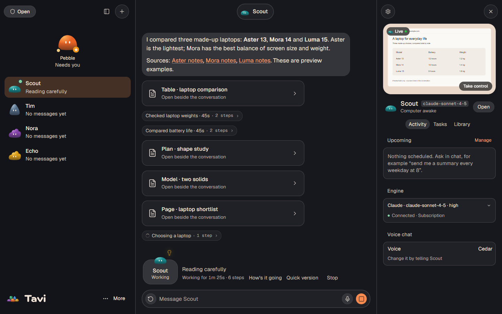
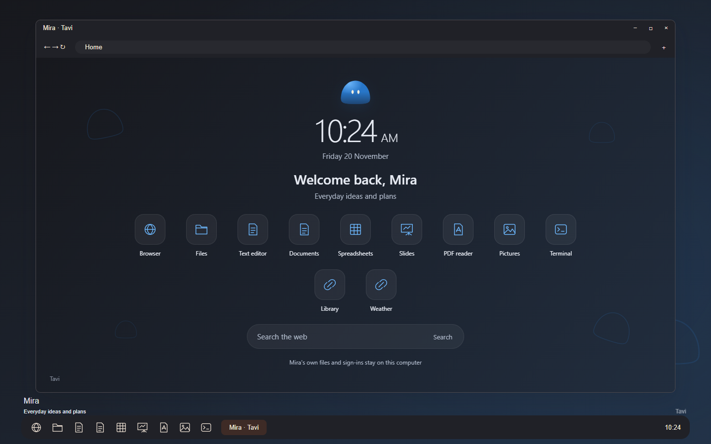
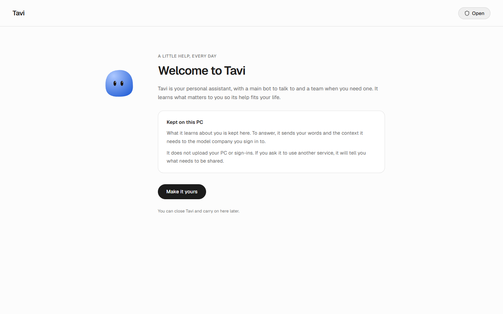
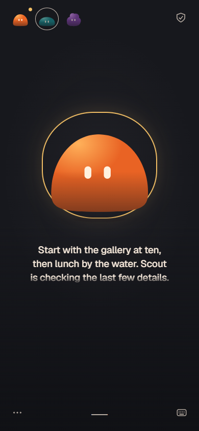

# Tavi

Tavi is a personal AI system that runs on your own Windows PC. You talk to a main bot. It gets to
know you, keeps track of things for you, and can hand separate jobs to other bots, each with its
own name, face, colour and, if you want, its own computer that you can watch and take over. You use
it from a desktop app, or from your phone while the PC is on.

The bots think with your own Claude and OpenAI subscriptions. There is no Tavi service and no Tavi
account: what it learns about you is kept on your PC.

**This is an early edition.** It has been used daily on one PC and installed from scratch once on a
clean trial. Expect rough edges, read [the limits](#limits-and-rough-edges) before relying on it,
and read [the safety guide](docs/SAFETY.md) before giving a bot a computer or connecting accounts.

If you are an AI coding helper setting this up for someone, read [CLAUDE.md](CLAUDE.md) first (the
same text is in [AGENTS.md](AGENTS.md)), then [INSTALL.md](INSTALL.md).

## Contents

- [What it is, and what it is not](#what-it-is-and-what-it-is-not)
- [A look around](#a-look-around)
- [What you need](#what-you-need)
- [What it costs](#what-it-costs)
- [Install](#install)
- [The first conversation](#the-first-conversation)
- [Everyday use](#everyday-use)
- [The parts and how they fit](#the-parts-and-how-they-fit)
- [The safety switch and your PIN](#the-safety-switch-and-your-pin)
- [Voice and the phone](#voice-and-the-phone)
- [Your information: where it lives, backing up, wiping](#your-information-where-it-lives-backing-up-wiping)
- [Everyday commands](#everyday-commands)
- [Updating](#updating)
- [When something is wrong](#when-something-is-wrong)
- [Limits and rough edges](#limits-and-rough-edges)
- [Contributing, licence and notices](#contributing-licence-and-notices)

## What it is, and what it is not

It is:

- **A main bot you talk to**, by typing or by voice, that learns who you are and what matters to you
  and uses that in every answer.
- **A team.** The main bot can propose a specialist bot for a lasting area of work (for example
  "trip planner" or "second opinion"). Each bot has a job card saying what it is for and which
  tools it may use. You approve every new bot.
- **Bots with computers.** A bot can have its own Linux desktop with a web browser and a terminal.
  You watch it live beside the conversation and can take control of it.
- **A keeper of things.** Reminders, follow-ups, routines that run at set times, memory you can
  read and correct, files and folders you choose to let it read, searchable pages it makes for you.
- **Careful by construction.** Anything that sends, spends, books, deletes or changes something
  outside your PC waits for your tap. A separate safety switch can pause, wall off or stop
  everything, and only you can reopen it.

It is not:

- A hosted service. Nothing runs when your PC is off.
- A guarantee that an AI answer is right. It shows its sources and its steps so you can check.
- A replacement for a professional's check. Calculators, drawings and 3D models are aids; a tidy
  result is not proof that a design is suitable for real use.
- Finished. See the limits.

## A look around

The desktop app has three parts: the team down the left, the conversation in the middle, and a
panel on the right that shows what the bot is working on, the things it has made, and its
computer's screen. The phone shows the same team and conversations in a smaller layout, with
voice and a watch-only view of a bot's computer.



A bot's own computer, as you see it when you open its screen:



The first screen of a new installation, and a conversation on the phone:





Everything in these pictures is made up.

## What you need

- **Windows 11, or Windows 10 version 22H2.** Windows' own Linux feature (WSL 2) must be switched
  on; the installer tells you exactly how if it is not. You must be able to approve an
  administrator prompt once for that.
- **Node 24, Python 3.10 or later, and Git**, installed the ordinary way.
- **About 15 GB of free disk and 8 GB of memory** (16 GB is much more comfortable once a bot has
  a computer). Each extra bot computer adds memory use.
- **Your own subscription to Claude or to ChatGPT (OpenAI)**, ideally both. You sign in yourself,
  inside the app. With both, a bot can carry on with the other when one reaches its limit, and you
  can give different bots different models.
- **An internet connection.**
- Optional: an OpenAI API key if you want to talk to it by voice; [Tailscale](https://tailscale.com)
  if you want to use it from your phone.

## What it costs

Tavi itself is free. You pay for your own subscriptions, and for voice use if you turn voice on
(that is billed to your own OpenAI API key). Long jobs, several bots, routines and unasked finds
all use your subscription allowance faster than a short chat does. A provider may change what its
subscription allows; Tavi cannot promise a model or a limit stays as it is today.

## Install

Get the code with Git (the green **Code** button on this repository's page shows the address to
clone), into an ordinary folder you can write to, and open a terminal in that folder. Then one
command does the rest, and it is safe to run again at any point:

```powershell
node scripts/tavi.mjs setup --check    # only looks, changes nothing
node scripts/tavi.mjs setup            # installs
```

[INSTALL.md](INSTALL.md) is the full guide: what to have ready, what each step does and how long
it takes, every failure and what to do about it, and how to undo it. In short, set-up:

1. checks the PC and tells you what is missing, without changing anything;
2. installs the project's packages and builds the app;
3. creates a Linux space of its own for the bots (called `tavi-bots`), locks it down and checks
   the locks. It never touches any other Linux installation on your PC;
4. installs the engine that runs the bots, at a fixed version;
5. installs the Tavi program for your Windows account and starts it.

It never asks for a password, key or sign-in code. It takes roughly 30 to 60 minutes, most of it
downloads.

## The first conversation

The first time you open Tavi it walks you through a few calm steps:

1. **Hello**: what Tavi is, and what does and does not leave your PC.
2. **Your main bot**: give it a name and a face, or keep the suggestion.
3. **Sign in** to Claude, OpenAI, or both, on the provider's own page.
4. **Your PIN** for the safety switch.
5. Optional, each skippable and findable later: voice, your phone, a computer for your main bot.

Then your main bot opens the conversation itself and gets to know you: who you are and what your
days are made of, what you are working on, the people around you, how you like to be spoken to,
what you would love taken off your plate, and what you never want it to do. It asks one thing at
a time and takes about ten to fifteen minutes. You can stop at any point and pick it up later, and
you can say "skip" to anything; it will not ask again.

You can also hand it what already exists: paste what another assistant knows about you, or drop in
a document about your work. It treats that as information about you, never as instructions, and
tells you what it took from it.

It ends by showing a page called **What I know about you** that you can correct by saying what is
wrong. Then it may propose, one at a time and each needing your yes: a specialist bot or two, a
routine worth having, whether to look for useful things unasked, and websites to keep handy on a
bot's computer.

Any time later: "get to know me better", "what do you know about me?" and "forget that" all work.

## Everyday use

- **Say the outcome you want**, and what it may and may not use. It will tell you how it read your
  request before starting anything long, and you can redirect it.
- **Watch the steps.** The conversation shows what the bot is doing. Results open beside it.
  **Stop** ends the current work.
- **Keep talking while it works.** A bot has one lane for conversation and another for longer
  jobs, so you can ask how it is going, or ask something else.
- **Approve what matters.** Sending, booking, deleting and changing things outside your PC appear
  as a card for your tap. Nothing of that kind happens without it.
- **Ask for a new bot** when an area of work deserves its own: "I'd like a bot that keeps an eye on
  my reading group's schedule." Your main bot drafts a job card, tries it on a made-up example, and
  shows you the card before anything is created.
- **Give a bot a computer** from its settings. It gets a Linux desktop with a browser and a
  terminal. Open its screen full size to watch; choose **Take control** to use it yourself, for
  example to sign in to a website. A bot can use any website you sign in to on its screen, so keep
  high-risk accounts (banking, your main email) off bot computers.
- **Choose the model.** Each bot's settings has its subscription, model and effort, with a fallback
  on the other subscription. Higher effort is slower and uses more of your allowance.
- **Routines** run at times you agree ("every weekday at 8, tell me what is on today"). Try one by
  hand before scheduling it.
- **Finds.** If you allow it, the main bot quietly looks a few times a day for something specific,
  sourced and useful to your situation, and tells you only when it finds one. Silence is a normal
  result.
- **Pages.** Ask for "a page I can search and save" when an answer is a long list. Pages can be
  saved as a single file.
- **Files.** Point it at folders you choose and it can find and read what is in them. Drawings,
  sketches, calculators and 3D models are there as tools if your work uses them.

## The parts and how they fit

| Part | What it does |
|---|---|
| **The app** (on Windows) | Holds everything that is saved: conversations, memory, settings, files it has indexed. Serves the desktop and phone screens. |
| **The safety switch** (a separate small program) | Starts and stops the bots' Linux space, checks its locks before any bot starts, and holds the four safety levels and your PIN. If the app misbehaves, the switch still works. |
| **The bots' Linux space** (`tavi-bots`) | Where the bots actually run. It cannot see your Windows drives, cannot start Windows programs, and cannot reach your home network or other devices; it can reach the internet and one checked door back to the app. Each bot is a separate Linux user that cannot read another bot's files. |
| **The engine** ([Hermes Agent](https://github.com/NousResearch/hermes-agent)) | Runs each bot's thinking and tool use inside that space, signed in to your subscriptions. |
| **The toolbox** | The one checked door from a bot to your information. Every tool call is checked against the bot's job card, the safety level and whether your approval is needed. A bot's own promises are not the safety boundary; this is. |
| **A bot's computer** | A Linux desktop inside the same space, shown to you live. |
| **Voice** | Speaks and listens through OpenAI's realtime voice model with your own key; the thinking is still done by your main bot. |
| **The phone view** | The same app, reached over your private network. |

More in [docs/ARCHITECTURE.md](docs/ARCHITECTURE.md), [docs/SAFETY.md](docs/SAFETY.md) and
[docs/TOOLS.md](docs/TOOLS.md) (every tool, listed from the code).

## The safety switch and your PIN

The switch is in the top corner of both apps. It has four levels:

| Level | What it means |
|---|---|
| **Open** | Normal. |
| **Paused** | Bots are frozen where they are. Opening it lets them carry on. |
| **Walled off** | The bots' Linux space is stopped and the tools are blocked. You can still read everything. |
| **Killed** | As walled off, and work on the Windows side is stopped too. |

Anyone can make it stricter, at once. Making it less strict needs your PIN. You choose the PIN on
the PC; a bot never sees it or sets it. The switch also closes by itself if a lock check fails
when the space starts.

If the app is not answering, the switch has its own commands, from a terminal in the project
folder: `npm run guard -- state` shows the level and `npm run guard -- kill` stops everything.

Words a bot reads on a web page, in a file, in a message or from another bot are information.
They cannot change what it is allowed to do.

## Voice and the phone

**Voice** is optional. Put your own OpenAI API key in a small file in the data folder and switch
voice on (INSTALL.md says exactly where and in what form). You then talk to your main bot from
the app or the phone. It answers in a short spoken style and puts detail on the screen.

**The phone** reaches the app over a private network you control. The installer does not install
or change one; if you use Tailscale, set-up prints the one command to run and the address to open
on your phone, and you add it to your home screen from there. Do not expose the app or the safety
switch to the public internet. The phone is a window onto your PC: when the PC is off or asleep,
it has nothing to show.

## Your information: where it lives, backing up, wiping

- **The data folder** (`data` inside the project, unless you chose another) holds the database,
  your profile, indexed documents, settings, logs and the safety switch's own records. If you let
  set-up create the Linux space, its disk is in `data/linux`.
- **The bots' Linux space** holds each bot's own files and browser sign-ins, and your subscription
  sign-ins for the engine.
- **What leaves the PC**: the words you say and the context a bot needs, sent to the model company
  you signed in to; pages a bot fetches; anything you approve sending. Web searches are checked
  first so that names, phone numbers, email addresses and street addresses are not put into a
  search.

**Back up** with Tavi stopped (`node scripts/tavi.mjs stop`): copy the whole data folder. A backup
holds private information and sign-ins; protect it like the PC. Sign-ins may not open under
another Windows account, so expect to sign in again after moving PCs.
[docs/UPDATING.md](docs/UPDATING.md) covers backing up and moving in detail.

**Wipe**: `node scripts/tavi.mjs uninstall` removes the program and its start-up entry and keeps
your data. `node scripts/tavi.mjs uninstall erase` also removes the bots' Linux space and the data
folder, after saying what will be lost. Nothing else on the PC is touched. Remember to sign out
on the providers' own sites too if you want the sessions gone.

## Everyday commands

From a terminal in the project folder:

| Command | What it does |
|---|---|
| `node scripts/tavi.mjs status` | Is it running, the mode, the safety level, each bot and its engine, the last errors |
| `node scripts/tavi.mjs doctor` | Every check, each with what to do if it fails |
| `node scripts/tavi.mjs start` / `stop` / `restart` | The obvious |
| `node scripts/tavi.mjs logs` | Recent log lines, with private values hidden |
| `node scripts/tavi.mjs update` | Fetch the latest version and bring this installation up to it |
| `node scripts/tavi.mjs uninstall` | Remove the program, keep the data |

## Updating

`node scripts/tavi.mjs update` stops Tavi, fetches the latest version, installs what changed,
re-checks the Linux space's locks and starts it again. Back up first. Read
[CHANGELOG.md](CHANGELOG.md) for what is new. More in [docs/UPDATING.md](docs/UPDATING.md).

## When something is wrong

Start with `node scripts/tavi.mjs doctor`: each failing line says what to do. Then
[docs/TROUBLESHOOTING.md](docs/TROUBLESHOOTING.md). The usual causes, in order: the safety switch
is not open; a subscription has reached its limit or needs signing in again; the PC went to sleep;
the phone is not on the private network. When asking for help, share a short error line and the
steps with made-up information, never your logs or data folder.

## Limits and rough edges

- It has been tried on very few PCs. The installer was proven once on a clean Linux space; the
  parts that install the desktop program and its start-at-sign-in entry were built but not
  exercised in that trial.
- Windows only. The PC must stay on, and awake, for the phone and for routines.
- Web search works through a provider's own command-line program on the PC when one is installed
  and signed in. Without one, a bot can still read a page whose address it knows.
- Mail, calendar and file-storage tools depend on connections you set up with the provider; a
  tool being listed does not mean it is connected.
- Reference books and standards are not supplied. The reference shelf reads documents you put
  there yourself.
- 3D rendering needs Blender installed separately.
- Voice has had little testing beyond one voice and one accent.
- Some inner pages and tool names still show their origins in an earlier, single-bot version of
  this system.
- Subscription sign-in for the engine depends on what the providers allow. If a provider changes
  that, a bot may need a different way to sign in.

## Contributing, licence and notices

Read [CLAUDE.md](CLAUDE.md) for the folder map, the commands and the rules that must not be
broken. Use a separate data folder and made-up examples; never commit logs, profiles, keys or
screenshots of real information. A change should come with a small test that proves the behaviour
or protects a boundary. Changes to permissions, the Linux space or how data is stored deserve a
conversation first. How this public edition is produced is in
[docs/PUBLIC-EDITION.md](docs/PUBLIC-EDITION.md).

Tavi's own code is under the [MIT licence](LICENSE), copyright Tavi contributors. The desktop look
is adapted from [Bot HQ](https://github.com/nickvasilescu/bot-hq) (MIT), and the bots run on
Hermes Agent; these and every other borrowed part are credited, with their licences, in
[THIRD-PARTY.md](THIRD-PARTY.md). Your subscriptions and any website a bot visits have their own
terms.
